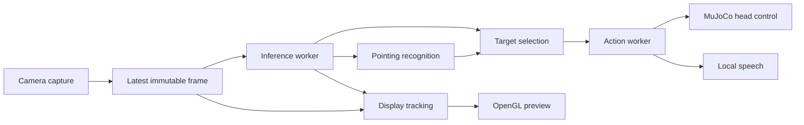

# reachy-detection

A local vision pipeline for Reachy Mini: MediaPipe hand landmarks, YOLO26 object
inference, deterministic pointing-based target selection, and asynchronous MuJoCo
head control with spoken object labels.

Capture, inference, rendering, and robot responses run independently. The preview
targets 60 FPS; recognition operates at the measured model completion rate.

## Installation

The runtime uses Python 3.12 and the pinned dependencies in
[`requirements.txt`](requirements.txt). The preview requires a graphical session
with OpenGL 2.1 support. Camera input is provided through OpenCV; macOS Continuity
Camera can expose an iPhone as a capture device.

```bash
conda create -n reachy-detection python=3.12 -y
conda activate reachy-detection
python -m pip install -r requirements.txt
python prepare_yolo.py
```

`prepare_yolo.py` downloads YOLO26s weights and exports the ONNX graph and label
metadata to `models/`. Export dependencies are installed in a temporary virtual
environment, isolated from the runtime's OpenCV installation. PyTorch and
Ultralytics are export dependencies; runtime object inference uses OpenCV DNN.

The Hand Landmarker asset downloads automatically on first use. Model binaries
and generated metadata are excluded from Git. Network access is required for
initial dependency installation and model preparation; inference runs locally.
The application does not record camera frames.

## Execution

```bash
python main.py
```

The default configuration enables hand tracking, pointing recognition, object
detection, target selection, simulated head movement, and speech. Camera index
`0` and a mirrored preview are the defaults.

Full simulation runs in a separate process. On macOS:

```bash
conda activate reachy-detection
mjpython simulator.py
```

The controller connects to `http://127.0.0.1:8000` using the default robot name
`reachy_mini`. It requires a running full MuJoCo simulation; the
desktop application's mockup daemon does not satisfy this requirement. A daemon
already occupying the port must be stopped before launching the simulator.

Vision without robot or speech output:

```bash
python main.py --no-robot --mute
```

### Command-line interface

| Option | Default | Behaviour |
| --- | --- | --- |
| No mode flags | Combined | Enable both models, target selection, robot control, and speech. |
| `--hand` | — | Hand landmarks and pointing only; robot and speech disabled. |
| `--object` | — | Object detection only; robot and speech disabled. |
| `--hand --object` | — | Explicit combined mode. |
| `--camera INDEX` | `0` | OpenCV capture device index. |
| `--fps RATE` | `60` | Preview target and requested camera rate; range `1–120`. |
| `--no-mirror` | Mirroring enabled | Use the original camera orientation. |
| `--model PATH` | `models/hand_landmarker.task` | Hand Landmarker asset. |
| `--object-model PATH` | `models/yolo26s.onnx` | ONNX or legacy TFLite object model. |
| `--score-threshold VALUE` | `0.35` | Object display and selection threshold; range `0.10–1.00`. |
| `--no-robot` | Robot enabled in combined mode | Disable simulated head movement. |
| `--mute` | Speech enabled in combined mode | Disable spoken labels. |
| `--download-model-only` | — | Download missing hand or legacy TFLite assets and validate ONNX/JSON files, without capture. Does not export YOLO. |
| `--list-object-labels` | — | Print the selected detector's supported labels, excluding `person`, without capture. |

Mode defaults apply independently of other options. For example, `--fps 30`
changes the requested rate while retaining the combined pipeline.

### Keyboard controls

| Key | Action |
| --- | --- |
| `Q`, `Esc` | Exit. |
| `M` | Toggle mirroring and invalidate the previous inference generation. |
| `R` | Reset pointing, display tracking, target selection, and pending actions; available with hand tracking. |
| `D` | Toggle diagnostics for up to three candidates below the display threshold. |
| `-`, `+` | Adjust the object threshold by `0.05`, bounded to `0.10–1.00`. |

Object diagnostics and threshold controls are available whenever object detection
is enabled. The pointing arrow is drawn only for a valid pointing result and is
hidden when the gesture is bent, missing, stale, or ambiguous.

## Architecture



| Module | Responsibility |
| --- | --- |
| [`main.py`](main.py) | CLI, frame orchestration, preview pacing, and state resets. |
| [`camera_capture.py`](camera_capture.py) | Background capture and the latest immutable BGR frame. |
| [`vision_worker.py`](vision_worker.py) | Model ownership, bounded pending work, result identity, and error propagation. |
| [`hand_tracking.py`](hand_tracking.py) | MediaPipe lifecycle, landmark extraction, and skeleton rendering. |
| [`gesture_recog.py`](gesture_recog.py) | Index-extension classification and pointing direction. |
| [`object_detection.py`](object_detection.py) | Model loading, output decoding, category filtering, and box rendering. |
| [`target_selection.py`](target_selection.py) | Ray–box intersections, ambiguity rejection, and target confirmation. |
| [`preview_tracking.py`](preview_tracking.py) | Optical flow, source-frame alignment, smoothing, and visual retention. |
| [`preview_window.py`](preview_window.py) | Main-thread GLFW/OpenGL rendering and input events. |
| [`interaction.py`](interaction.py) | Target identity, action scheduling, cancellation, and speech suppression. |
| [`robot_control.py`](robot_control.py) | Simulator validation and bounded image-relative head commands. |
| [`speech.py`](speech.py) | Local speech subprocess lifecycle. |
| [`simulator.py`](simulator.py) | Full MuJoCo launch with the virtual camera disabled by default. |
| [`prepare_yolo.py`](prepare_yolo.py) | Isolated model export and metadata generation. |

`gesture_recognition.py` re-exports the gesture interface for compatibility.
Running `hand_tracking.py` forwards to the main application.

### Frame and result contracts

`CameraFrame` contains a read-only BGR array, a monotonically increasing capture
sequence, and a monotonic capture timestamp. The main thread copies that array
before mirroring or annotation.

The inference worker owns one active frame and one replaceable pending frame.
New submissions replace pending work rather than building a FIFO backlog. Both
models receive the same unannotated RGB image and monotonically increasing
MediaPipe timestamp.

`FrameResult` carries the source sequence, orientation/size generation, capture
time, completion time, inference duration, and paired hand/object results.
Generation mismatches invalidate a result. Source age is measured from capture,
including time spent pending and inside inference. Repeated preview redraws do
not create new capture or model observations.

## Vision models

### Object detection

The default detector is a static, float32 YOLO26s ONNX export with `640 × 640`
input and opset `12`. Input preparation preserves aspect ratio with RGB
letterboxing, padding value `114`, and `1/255` normalization. Decoding reverses
the resize and padding to recover coordinates in the source image.

Each ONNX graph has a JSON sidecar containing its label map, input size, output
format, and export metadata. Decoder selection follows this metadata:

| Model family | Output | Postprocessing |
| --- | --- | --- |
| YOLO26 | `[1, N, 6]`: `x1, y1, x2, y2, score, class_id` | Final NMS-free predictions; no additional NMS pass. |
| YOLO11 | `[1, 4 + classes, anchors]`: centre coordinates, dimensions, class scores | Maximum class score followed by class-agnostic NMS at IoU `0.5`. |
| EfficientDet-Lite0 | MediaPipe Object Detector result | Legacy `.tflite` backend. |

The inference score floor is `0.10`; the default display and selection threshold
is `0.35`. YOLO decoding retains at most 30 candidates, and the application
retains at most 10 visible objects. `person` is excluded before display and target
selection. The pretrained YOLO models use the 80-class COCO label set.

Alternative exports:

```bash
python prepare_yolo.py --size n
python main.py --object-model models/yolo26n.onnx

python prepare_yolo.py --family 11 --size s
python main.py --object-model models/yolo11s.onnx
```

The legacy backend is selected with
`--object-model models/efficientdet_lite0.tflite`; a missing TFLite asset is
downloaded automatically.

### Hand landmarks and pointing

MediaPipe Hand Landmarker runs in `VIDEO` mode with a maximum of two hands.
Detection, presence, and tracking confidence thresholds are each `0.5`. The
application consumes image landmarks; world-coordinate landmarks are unused.

Pointing uses only index-finger landmarks `5, 6, 7, 8`. For image points `p_i`:

```text
L = ||p6 - p5|| + ||p7 - p6|| + ||p8 - p7||
D = ||p8 - p5||
extension = D / L
pointing = extension >= 0.85, with D >= 5 px and L >= 5 px
```

Other fingers do not affect classification. An extended index is accepted on the
first fresh result; an open palm or V sign can therefore qualify. Two qualifying
hands produce an ambiguous gesture. Non-finite, malformed, or insufficiently
projected index coordinates are rejected.

The arrow originates at `p8` and follows `(p8 - p5) / D`. Its display position can
use the corresponding smoothed hand, while target geometry uses the original
model coordinates. Recognition is two-dimensional: foreshortening can reduce the
visible index below the minimum length.

### Target selection

For image diagonal `d`, the selector intersects the forward pointing ray with
axis-aligned object boxes padded by `0.005d`. A slab intersection supplies entry
and exit distances; boxes behind the origin are rejected.

Intersections are ordered by entry distance. The nearest candidate is rejected
as ambiguous when the next candidate enters at or before the first exit distance plus `0.02d`.
Detector confidence does not resolve overlapping ray candidates.

A target confirms after two distinct inference results with the same category
and bounding-box IoU of at least `0.3`. Duplicate result sequences cannot advance
confirmation. A bent or missing gesture, invalid ray, absent intersection, or
ambiguous candidate clears selection. Confirmed objects receive a green box;
unselected detections retain their standard box colour.

## Timing and display tracking

Capture requests `960 × 540`, a one-frame backend buffer, and the configured frame
rate. Frames wider than 960 pixels are resized proportionally. The capture
thread retains only its latest frame, so a blocking device read does not block
the preview loop.

GLFW events and OpenGL operations remain on the main thread. Rendering reuses a
BGR texture and an aspect-preserving viewport. Vsync is disabled; application
frame deadlines control pacing.

Display motion uses batched forward/backward pyramidal Lucas–Kanade optical flow
and exponential smoothing for up to two hands and ten boxes. A clean grayscale
history aligns delayed predictions with the current image. Object tracks use up
to twelve corner features per box.

| Constraint | Value |
| --- | --- |
| Default preview target | `60 FPS` |
| Maximum raw source age for gesture and selection | `300 ms` |
| Maximum source age for displayed tracks | `500 ms` |
| Retention after a missed model observation | Up to `220 ms`, subject to source-age expiry |
| Source-frame history | Up to `750 ms` or 90 frames |
| Independent action freshness limit | `500 ms` |

Display estimates affect rendering only. They cannot confirm a gesture or target,
retain a selected highlight without a matching fresh raw detection, or authorize
robot actions. Mirror and image-size changes reset tracking and inference
generations. Gesture resets and threshold changes clear the relevant selection
and pending-action state.

The status panel separates preview FPS, distinct camera-frame FPS, model
completion Hz, inference duration, and source age. A 60 FPS preview may redraw
between camera arrivals or model completions; the display target does not imply
60 Hz neural inference. Optical flow can lose accuracy under occlusion, rapid
motion, or low texture, and retained geometry expires under the limits above.

## Simulator and response control

`simulator.py` requires the pinned `reachy-mini==1.8.0` API. It launches full
MuJoCo with `--sim --no-media` and applies a process-local override to the
backend's virtual-camera rendering loop. The visible viewer, physics, SDK server,
and head control remain active. Installed SDK files are not modified.

The SDK's virtual eye-camera loop is separate from its media backend and adds
rendering and UDP work even with `--no-media`. It can be restored explicitly:

```bash
mjpython simulator.py --virtual-camera
```

The robot controller validates running full-simulation status through the local
HTTP endpoint and SDK before movement. The SDK connection uses
`localhost_only`, `no_media`, and disabled automatic body yaw.

For bounding-box centre `(cx, cy)` in an image of size `(W, H)`:

```text
u = clamp(2cx / W - 1, -1, 1)
v = clamp(2cy / H - 1, -1, 1)
u = -u if the preview is mirrored
yaw   = -30u degrees
pitch =  15v degrees
```

Positive yaw turns left; positive pitch turns down. Commands use a `0.6 s`
trajectory and zero body yaw. This is an image-relative mapping without camera
intrinsics, extrinsics, or depth estimation.

The action worker owns one active response and one replaceable pending target.
Target identity uses category and IoU `>= 0.3`. Speech occurs once per selection
episode; reselection after at least `0.75 s` of loss starts a new episode.
Continuous-target gaze updates require normalized centre displacement of at
least `0.05` and a dispatch interval of at least `0.6 s`. Failed responses can
retry after `3 s` while fresh selection persists.

Losing selection cancels pending work and suppresses speech following an outdated
movement. An in-flight movement or spoken label may finish. Robot and voice
failures are reported independently without stopping capture or inference.

Speech uses the first available backend: macOS `say`, `espeak-ng`, or `espeak`.
Labels are passed over standard input without shell evaluation. Each speech
process has a `10 s` timeout. Audio uses the computer's selected output device.

## Verification

```bash
python -m unittest discover -v
```

The suite covers gesture geometry, coordinate conversion, ONNX decoding, person
exclusion, ray ambiguity, target identity and confirmation, frame freshness,
generation resets, capture and inference scheduling, display tracking, GUI
resource ownership, simulator gating, action cancellation, and speech cleanup.
Device, GUI, and SDK boundaries use test doubles in the automated suite.

With the simulator running, the standalone head diagnostic is:

```bash
python demo_head.py
```
